# McFly Inventario

Sistema web de control de inventario para **McFly**, un negocio de autolavado con dos sucursales (**McFly Centro** y **McFly Villa**). Proyecto de portafolio desarrollado como si fuera un encargo real: partió de una entrevista con el cliente, de la que salieron los requerimientos, el modelo de datos y el alcance.

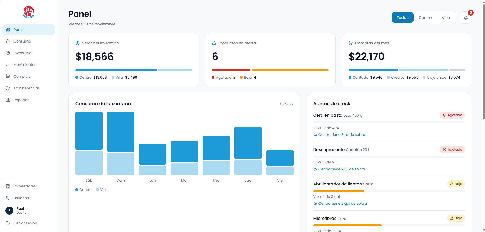

## El problema

El dueño controlaba su inventario con libretas, hojas de Excel y preguntándole a sus empleados cuánto producto quedaba. Esto provocaba:

- **Pérdida de productos:** no sabía si lo que compraba se usaba bien o se desperdiciaba.
- **Compras innecesarias:** compraba producto que ya tenía en la otra sucursal.
- **Falta de control:** no podía confirmar si las cantidades reportadas eran reales.
- **Falta de información:** no sabía cuánto dinero tenía invertido en producto.

## La solución

Una herramienta que responde **qué hay, dónde está y cuánto se gasta**, con historial completo de movimientos y trazabilidad de quién hizo cada uno.

| Pantalla | Para qué sirve |
|---|---|
| **Panel** | Valor del inventario, alertas de stock bajo con sugerencia de qué sucursal tiene sobrante, compras del mes, consumo de la semana, transferencias por confirmar y últimos movimientos. |
| **Consumo** | Pantalla pensada para celular: el empleado elige el producto (con foto), la cantidad y registra. Avisa si no alcanza el stock. |
| **Inventario** | Catálogo con existencias por sucursal, estado (bien, bajo, agotado), edición de productos, fotos y stock mínimo por sucursal. |
| **Compras** | Registro de compras con varias líneas, proveedor, forma de pago y ticket. Sugiere el último precio del proveedor. |
| **Transferencias** | Envío entre sucursales en dos pasos: sale del origen y llega al destino cuando quien recibe lo confirma. |
| **Movimientos** | Historial inmutable con filtros por tipo, producto, usuario, sucursal y fechas. |
| **Reportes** | Consumo por producto, mermas, compras por proveedor y valor del inventario, con exportación a CSV. |
| **Proveedores** | Alta, edición y desactivación de proveedores con su contacto (solo el dueño). |
| **Usuarios** | Alta, edición, contraseñas y desactivación de cuentas (solo el dueño). |

### Capturas

**Panel del dueño**


| Inventario | Transferencias |
|---|---|
| 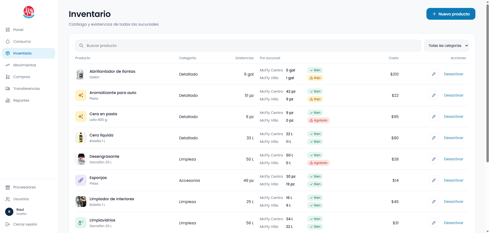 | 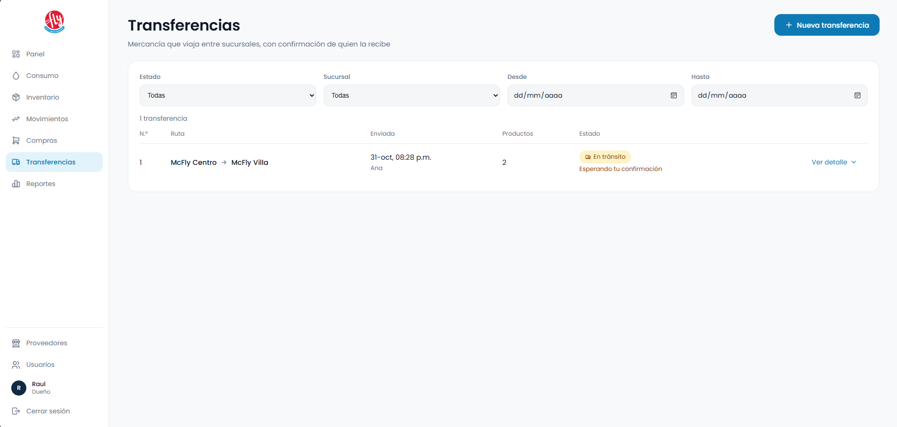 |

| Consumo | Panel en celular |
|---|---|
| 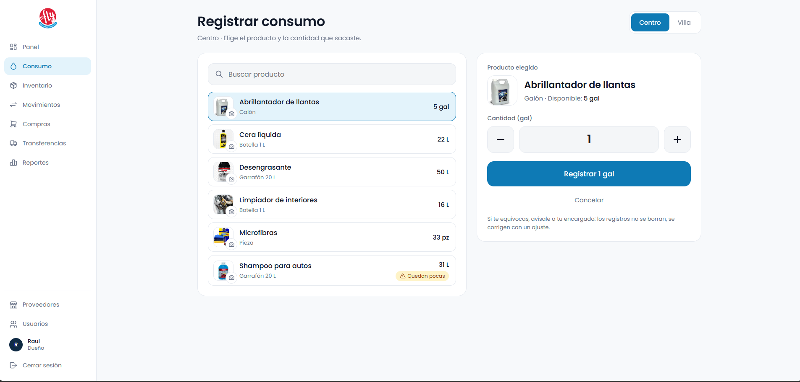 | 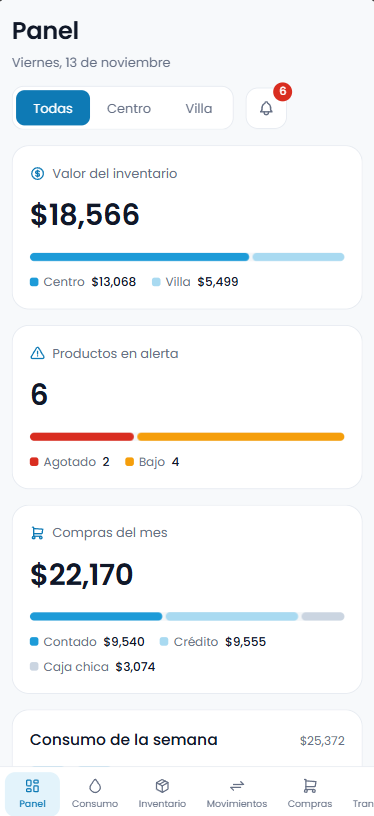 |

<details>
<summary>Ver más pantallas</summary>

**Inicio de sesión**

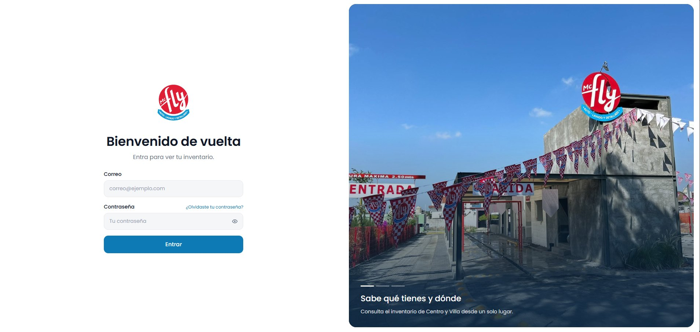

**Movimientos**

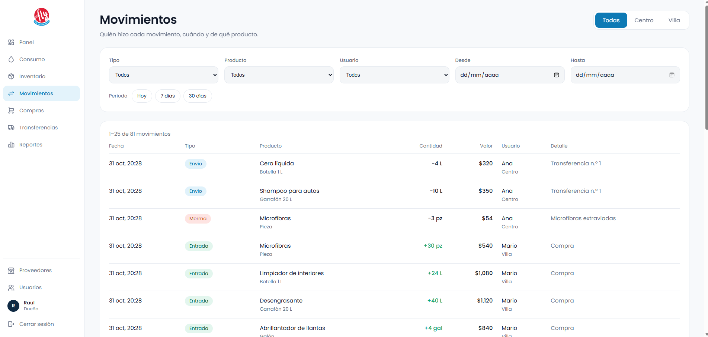

**Compras**

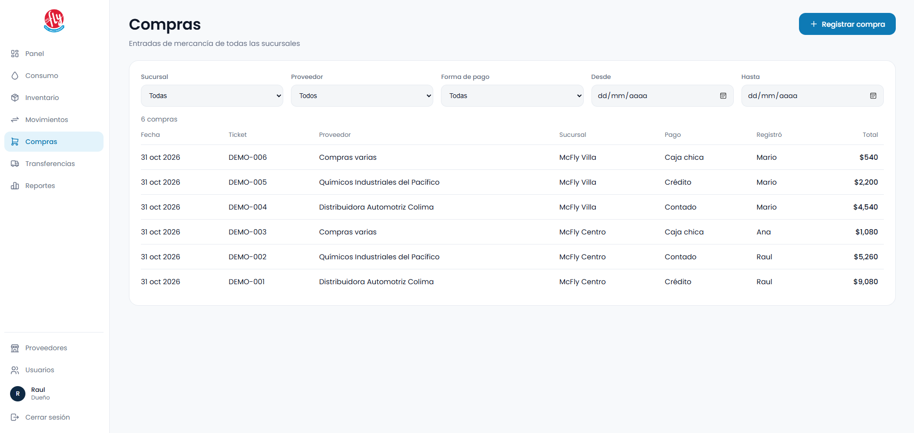

**Reportes**

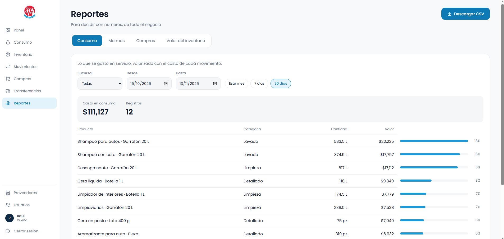

**Proveedores**

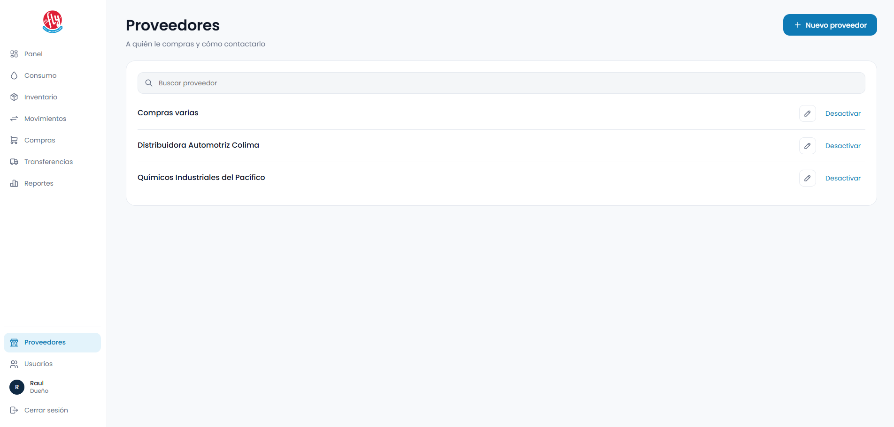

**Usuarios**

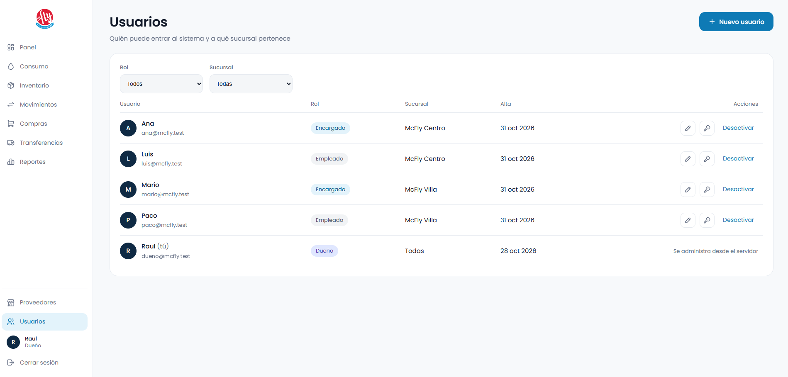

</details>

## Roles y permisos

| | Dueño | Encargado | Empleado |
|---|:---:|:---:|:---:|
| Registrar consumo y mermas | ✔ | ✔ | ✔ (su sucursal) |
| Ver inventario y costos | ✔ todas | ✔ su sucursal | — |
| Registrar compras y transferencias | ✔ | ✔ su sucursal | — |
| Confirmar recepción de transferencias | ✔ | ✔ si es el destino | — |
| Historial y reportes | ✔ todas | ✔ su sucursal | — |
| Editar productos, mínimos y fotos | ✔ | — | — |
| Administrar usuarios y proveedores | ✔ | — | — |

Los permisos se validan **en el servidor** en cada petición; el menú del frontend solo refleja lo que cada rol puede hacer.

## Decisiones de diseño clave

- **El stock no se guarda, se calcula.** Se obtiene sumando y restando movimientos firmados (vista `v_stock`), por lo que no se puede alterar sin dejar rastro.
- **Los movimientos son inmutables.** Un trigger bloquea `UPDATE` y `DELETE`; un error se corrige con un movimiento de **ajuste** con motivo.
- **Nada se elimina, se desactiva** (usuarios, productos, proveedores, sucursales), para no romper el historial.
- **Sin stock negativo, ni con concurrencia.** Las operaciones que restan stock corren en transacciones con bloqueos por producto y sucursal (`sp_getapplock`), tomados siempre en el mismo orden para evitar interbloqueos.
- **Transferencias atómicas.** Crear descuenta del origen y deja la transferencia pendiente; confirmar usa un `UPDATE ... WHERE estado = 'pendiente'`, así que si dos personas confirman a la vez solo una lo logra. La entrada conserva el costo con el que salió.
- **Costo promedio ponderado** calculado desde el detalle de las compras, con el último costo como respaldo.
- **Sesión revisada contra la base de datos en cada petición.** Desactivar a un usuario le quita el acceso de inmediato, aunque tenga un token vigente.
- **Fotos de producto en la base de datos** (256×256 webp, reducidas en el navegador, con verificación de formato en el servidor y versión para refrescar la caché).
- **Validación con zod** en todas las entradas y mensajes de error en español.

## Stack tecnológico

| Capa | Tecnología |
|---|---|
| Frontend | React (Vite), react-router-dom, Tabler Icons, Poppins |
| Backend | Node.js + Express, zod |
| Base de datos | SQL Server (paquete `mssql`) |
| Autenticación | JWT + bcryptjs |
| Control de versiones | Git + GitHub (ramas `feature/*` → `develop` → `master`) |

## Estructura del repositorio

```
mcfly-inventario/
├── backend/
│   └── src/
│       ├── config/        Conexión a la base de datos
│       ├── middleware/    Autenticación, validación, errores
│       ├── routes/        Endpoints de la API
│       ├── services/      Reglas de negocio y transacciones
│       ├── scripts/       Crear dueño y datos de demostración
│       └── utils/
├── frontend/
│   └── src/
│       └── api/  components/  context/  pages/  styles/  utils/
├── database/
│   ├── schema.sql         Esquema completo
│   └── migraciones/
├── docs/
│   └── requerimientos.md
└── README.md
```

## Cómo correrlo en tu computadora

**Requisitos:** Node.js 20 o superior, SQL Server (Express o Developer) y SQL Server Management Studio.

### 1. Base de datos
1. Conéctate a tu instancia (por ejemplo `localhost\SQLEXPRESS`).
2. Crea la base `mcfly_inventario` y ejecuta `database/schema.sql` completo.
3. Verifica con `SELECT * FROM sucursales;`: deben aparecer McFly Centro y McFly Villa.

### 2. Backend
```bash
cd backend
npm install
```
Crea `backend/.env` con tus datos:

```env
PORT=3000
DB_SERVER=localhost
DB_PORT=1433
DB_NAME=mcfly_inventario
DB_USER=mcfly_app
DB_PASSWORD=tu_contraseña
JWT_SECRET=un_texto_largo_y_aleatorio
```

Crea al dueño y, si quieres, los datos de demostración:

```bash
node src/scripts/crear-dueno.js
node src/scripts/seed-demo.js
npm run dev
```

### 3. Frontend
```bash
cd frontend
npm install
npm run dev
```
Abre `http://localhost:5173`. Vite redirige `/api` al backend en el puerto 3000.

### Cuentas de demostración

Las crea `seed-demo.js`. **Son solo para desarrollo:** no uses esas contraseñas en un despliegue real.

| Rol | Correo | Contraseña |
|---|---|---|
| Encargada (Centro) | `ana@mcfly.test` | `Demo12345` |
| Empleado | `luis@mcfly.test` | `Demo12345` |

El dueño se crea con `crear-dueno.js`.

## Documentación

- [Requerimientos del cliente](docs/requerimientos.md)

## Estado del proyecto

- [x] Levantamiento de requerimientos
- [x] Modelo de datos y esquema completo en SQL Server
- [x] Backend: autenticación, roles, productos, proveedores, movimientos, stock, compras, transferencias, resumen y reportes
- [x] Frontend: login, panel, consumo, inventario, compras, transferencias, movimientos, reportes y usuarios
- [x] Fotos de producto
- [x] Capturas
- [ ] Despliegue

## Autor

Raul Alejandro Chavez Torres · [GitHub](https://github.com/raulchvzt)
